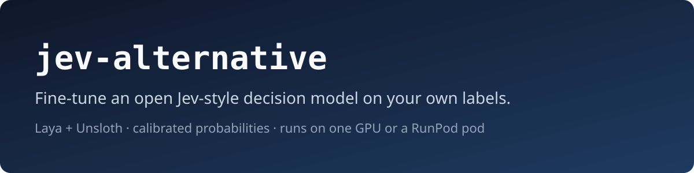

# jev-alternative

<p align="center">
  
</p>

**A free, open-source Jev alternative you can fine-tune on your own data.**

[Jev](https://madewithjev.com/jev-fine-tune) is TypeSafe's hosted decision model. You send it a piece of text and some typed questions, and it returns probabilities for each answer. The weights aren't released, so you can't fine-tune it or run it yourself. This repo takes [Laya](https://huggingface.co/convaiinnovations/laya), an open Jev-style decision model with Apache-2.0 weights, and fine-tunes it on your labelled decisions with [Unsloth](https://unsloth.ai/docs/basics/train-your-own-decision-model-with-unsloth). It then calibrates the result on a holdout and compares base vs fine-tuned on a separate test set.

Built by [Devrecated](https://devrecated.com). Deploy and serve with [runhug](https://runhug.devrecated.com), our CLI that puts Hugging Face models on RunPod GPUs.

## Get started in 3 commands

```bash
# 1) Install (needs one CUDA GPU; no GPU? see "Deploy and serve with runhug" below)
git clone https://github.com/devrecated/jev-alternative && cd jev-alternative && pip install -r requirements.txt

# 2) Check your data
python validate_data.py data/*.jsonl

# 3) Smoke-test a LoRA fine-tune on one of the sample categories
python train_laya.py --category customer-support --mode lora --max-steps 60
```

## Sample categories

`samples/` has a small synthetic dataset for each of the industries below. We picked them from the use-case map in TypeSafe's own Jev docs ([docs.typesafe.ai/concepts/use-case-map](https://docs.typesafe.ai/concepts/use-case-map)). We aren't affiliated with TypeSafe, and the rows are made up: no real people, patients or customers.

| `--category` | Industry (as TypeSafe lists it) | What the sample model decides |
|---|---|---|
| `customer-support` | Customer support | team, refund request, urgency |
| `insurance-claims` | Insurance claims | claim type, missing info, complexity |
| `financial-crime` | Financial crime | AML typology, escalate, risk |
| `legal-compliance` | Legal and compliance | document type, violation, severity |
| `recruiting` | Recruiting | role match, must-haves, evidence strength |
| `lead-scoring` | Lead generation | segment, purchase intent, ICP fit |
| `ecommerce-listings` | E-commerce marketplaces | category, counterfeit/prohibited flag, quality |
| `content-moderation` | Moderation and trust and safety | policy broken, remove, severity |
| `llm-guardrails` | LLM guardrails | injection / data exposure / unsafe advice, block, review level |
| `research-screening` | Scientific discovery (medical and pharma literature) | study design, inclusion, methods completeness |

Each folder has 30-34 training rows, 6-10 test rows and a short README. Pass `--category NAME` instead of `--train`/`--test`. Regenerate them with `python tools/make_samples.py`.

> **Medical and pharmaceutical disclaimer.** The `research-screening` rows are invented abstracts. They aren't clinical evidence, and a model trained on them isn't a medical device. Don't use it for diagnosis, treatment, dosing or regulatory decisions.

Your own data matters more than these. Forty rows will show you the format and run a smoke test, but you need a few hundred real labelled rows before the calibration numbers mean much.

## Features

- Fine-tunes Laya with LoRA (default), a full fine-tune, or head-only training.
- Answers the same three question types as Jev: `choice`, `score` and `noul` (yes/no).
- Calibrates one temperature per question type on a holdout, so probabilities can drive automation thresholds.
- Reports test-set accuracy, ECE, loss and record accuracy from Unsloth, plus a multi-class Brier score this script computes itself.
- Saves a merged 16-bit Laya checkpoint and a `devrecated_eval.json` with base and fine-tuned numbers side by side.
- Deploys with [runhug](https://runhug.devrecated.com) (pinned v0.4.4) and includes a training launcher with a hard spend cap that always terminates the pod.
- Ships ten synthetic sample datasets, one per industry, selectable with `--category`.
- Serves the fine-tuned model through Unsloth Studio's Jev-compatible `/v1/systemone` endpoint.

## How it works

| File | What it does |
|---|---|
| `train_laya.py` | Loads Laya in 16-bit and builds the dataset. Splits off a calibration holdout and evaluates the **base** checkpoint. Trains, calibrates, then evaluates the **fine-tuned** model on the test set. Saves the merged checkpoint and `devrecated_eval.json`. |
| `validate_data.py` | Checks JSONL rows against the Unsloth / Laya dataset rules and prints counts per label. |
| `data/sample_train.jsonl`, `data/sample_test.jsonl` | Made-up support-ticket rows (32 train, 10 test, 3 questions each). Same as `samples/customer-support/`. |
| `samples/<category>/` | Synthetic train/test JSONL plus a README for each industry. See [Sample categories](#sample-categories). |
| `scripts/serve_with_runhug.sh` | Installs a pinned runhug release and deploys your fine-tuned checkpoint to a RunPod serverless endpoint. |
| `scripts/runpod_train.py` | Runs `train_laya.py` once on a RunPod GPU pod, pulls back `train.log` and `devrecated_eval.json`, and always terminates the pod. |
| `scripts/serve_results.py` | Runs on the pod and serves results only to requests that carry the run's random bearer token. |

### Data format

One JSON object per line with `state`, `questions` and `gold`:

```json
{"state": "Hi, I was charged twice for invoice #4411. Please refund the duplicate today.",
 "questions": {
   "team":    {"type": "choice", "instructions": "Which team should handle this?",
               "criteria": {"billing": "invoices, payments, refunds, charges", "technical": "bugs, outages, errors, integrations",
                            "sales": "pricing, new plans, upgrades, quotes", "account": "login, access, users, settings"}},
   "refund":  {"type": "noul", "instructions": "Does the customer ask for a refund or credit?"},
   "urgency": {"type": "score", "instructions": "How urgent is this?", "criteria": ["not urgent", "soon", "today / blocking"]}},
 "gold": {"team": "billing", "refund": true, "urgency": 2}}
```

Gold rules: for `choice`, use a key of `criteria`. For `noul`, use `true` or `false`. For `score`, use the 0-based level index. Don't use yes/no or true/false as keys in choice questions. Take test rows from a different source, customer or time window than the training rows.

## Fine-tune with Unsloth

Unsloth reports about 2.5 GB of VRAM for its Laya fine-tune. Training uses bf16 when the GPU supports it and fp16 otherwise.

```bash
python -c "from unsloth import FastDecisionModel, DecisionTrainer"     # smoke test; set USE_TF=0 if it hangs

# Your data
python train_laya.py --train data/train.jsonl --test data/test.jsonl --checkpoint english --mode lora

# Reproduce the public benchmark (1,200 train / 400 test cases)
python train_laya.py --hf-dataset LocalLLaMA/typed-decisions --hf-config all --mode lora
```

Checkpoints: `--checkpoint english` (ModernBERT-large, 512 context), `multilingual` (mmBERT-base, for any non-English input) and `typed-decisions`. Modes: `--mode lora` (default), `full` and `head`.

Laya's settings differ from the LLM recipe in the Unsloth docs:

- Laya only loads in 16-bit. `load_in_4bit=True` raises `NotImplementedError` for Laya checkpoints.
- The defaults match Unsloth Studio's Laya defaults: LoRA `r=64`, `alpha=64`, encoder LR `8e-4`, 4 epochs, batch 8 × grad-accum 8, cosine schedule, weight decay 0.01. Head LR is `1e-4`. Start a full fine-tune at `2.5e-5`.
- `calibrate()` fits one temperature per question type and needs at least 10 held-out decisions of that type.
- `evaluate()` doesn't return Brier, so `train_laya.py` computes it from `FastDecisionModel.predict` and reports it as `brier_predict`.

### Serve it

```bash
UNSLOTH_SYSTEMONE_MODEL=outputs/laya-finetuned unsloth studio -H 0.0.0.0 -p 8888   # Jev-compatible /v1/systemone
```

## Deploy and serve with runhug

[runhug](https://runhug.devrecated.com) ([source](https://github.com/adamsiwiec1/runhug)) is how we deploy. It takes a Hugging Face repo, plans the GPU, shows the cost, and creates a RunPod serverless endpoint. RunPod is the backend runhug drives; you don't have to touch its console.

Push your checkpoint to the Hub, then hand it to the script. It installs runhug **v0.4.4** (pinned, checked against the release's SHA256SUMS) and does a dry run first:

```bash
python train_laya.py --category insurance-claims --push-to-hub YOUR_ORG/laya-insurance
runhug connect                                                   # one time: RunPod key via hidden prompt
scripts/serve_with_runhug.sh YOUR_ORG/laya-insurance             # runhug inspect + deploy --dry-run --estimate
scripts/serve_with_runhug.sh YOUR_ORG/laya-insurance --yes       # create the endpoint (this costs money)
```

The script only calls `runhug --version`, `runhug inspect`, `runhug deploy` and `runhug list`. To install runhug yourself instead: `go install github.com/adamsiwiec1/runhug/cmd/runhug@v0.4.4`, or see [runhug.devrecated.com](https://runhug.devrecated.com) for brew, apt, npm and the rest.

runhug deploys with worker-vLLM. It reads Laya as a 421M-parameter `text-classification` model and plans a 16 GB GPU at about $0.58/hr while workers are up. We have only run the dry run. We haven't checked how vLLM's classification endpoint lines up with Jev's `/v1/systemone` shape, so if you need that exact API, use Unsloth Studio (see "Serve it" above).

### Train on a rented GPU

No local GPU? `scripts/runpod_train.py` runs one training job on a RunPod pod and always tears it down:

```bash
export RUNPOD_API_KEY=...            # the launcher reads it from the environment; never commit it
python scripts/runpod_train.py --gpu "NVIDIA RTX A5000" --max-usd 5 -- --category financial-crime --mode lora
```

The launcher terminates the pod when training finishes, when the spend cap is hit, on any error and on Ctrl-C, then checks that the pod is gone. Results land in `results/<pod id>/`, which git ignores. While the pod runs, its result server on port 8000 answers only requests carrying a random token generated for that run. The token is printed once to your terminal and never written to `train.log`.

## FAQ

**Is this Jev?** No. It fine-tunes Laya, a separate open model built to answer the same kind of typed questions. It isn't affiliated with TypeSafe.

**Can I fine-tune Jev itself?** No. Jev runs behind TypeSafe's API and its weights aren't public. To use your own labels, you need an open model like Laya.

**Will it beat Jev?** Maybe, on your own task. Laya's published results show tasks where Jev still wins, so measure on your test set. Report test-set numbers only: base vs fine-tuned on the same rows, next to majority-class and random baselines. Slice by question type, label and number of options, and re-ask with the options shuffled. Switch only if Laya beats the best zero-shot option (Jev, Clef or an LLM) at an acceptable ECE.

**Do I need a big GPU?** No. Unsloth reports about 2.5 GB of VRAM for a Laya fine-tune.

**Has this run end to end?** The Unsloth API calls were checked against the `unsloth==2026.10.6` wheel (`unsloth/models/decision.py`), but they haven't run on a GPU yet. The RunPod launcher hasn't run against a live pod either. Treat your first run as a smoke test and watch the RunPod console.

## Contributing

Issues and pull requests are welcome. See [CONTRIBUTING.md](CONTRIBUTING.md). Report security problems privately as described in [SECURITY.md](SECURITY.md).

## License

[AGPL-3.0](LICENSE). Laya's weights are Apache-2.0. Unsloth's decision-model source files (`unsloth/models/decision*.py`, `_decision_common.py`) carry an `AGPL-3.0-only` header, and this repo imports them. Get legal advice before shipping this code inside a product or a hosted service.
